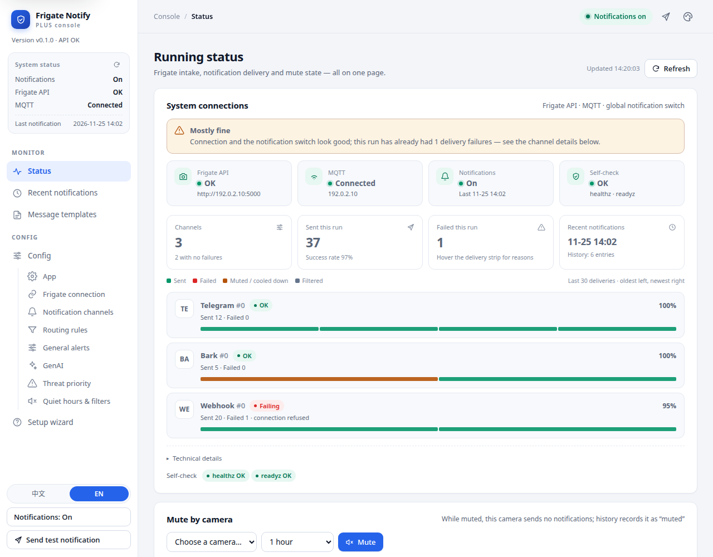
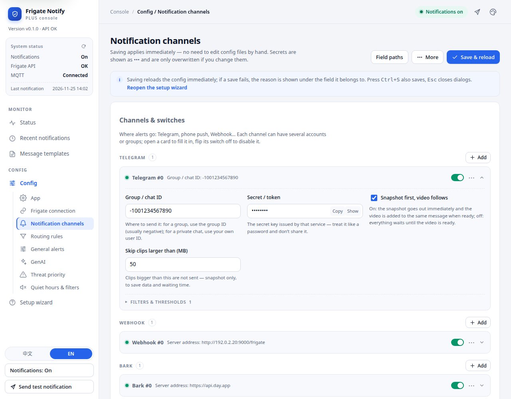
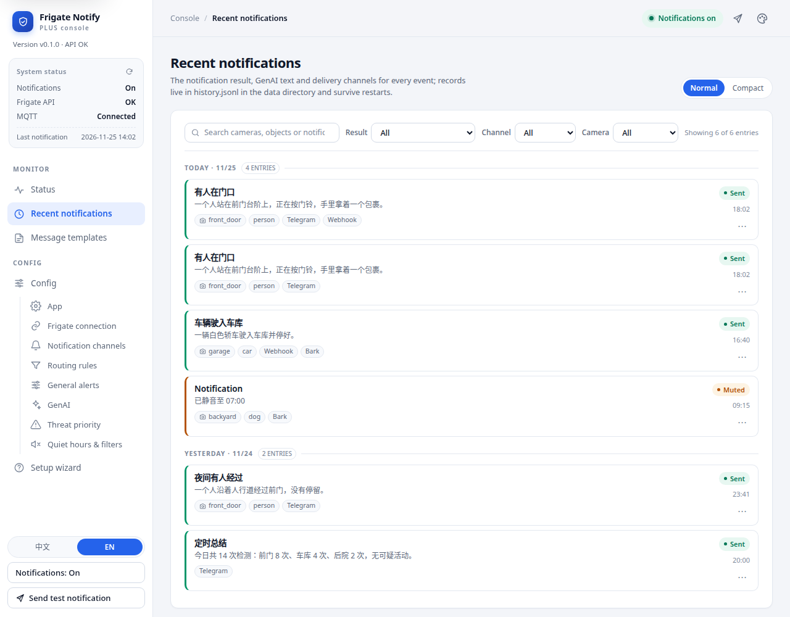
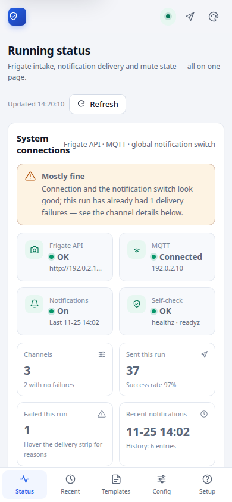

English | [简体中文](README.zh-CN.md)

# Frigate Notify Plus

[](https://github.com/izerok/frigate-notify-plus) [](https://github.com/izerok/frigate-notify-plus/releases) [](LICENSE) [](go.mod)

Frigate Notify Plus is a small Go sidecar for [Frigate](https://github.com/blakeblackshear/frigate) (0.18.x) that turns Frigate reviews and events into rich notifications — including Frigate's GenAI review descriptions — sent straight to your phone, with no Home Assistant required. Everything is configured from a built-in Web UI. It is a fork of [0x2142/frigate-notify](https://github.com/0x2142/frigate-notify) and keeps everything upstream does; the additions under [Key features](#key-features) are new in this fork.

## Contents

- [Screenshots](#screenshots)
- [Key features](#key-features)
- [Install](#install)
- [First run](#first-run)
- [Documentation](#documentation)
- [Attribution](#attribution)
- [License](#license)

## Screenshots

The Web UI console (port `8000`): a sidebar workbench with a status dashboard, notification history, full configuration forms, a tabbed template editor, and a first-run wizard. Four built-in themes (light by default), deep-linkable pages, and a bottom navigation bar on mobile.

| Status dashboard | Configuration — notification channels |
| --- | --- |
|  |  |

| Notification history | Mobile |
| --- | --- |
|  |  |

More screenshots (message templates, setup wizard) are in [docs/screenshots/](docs/screenshots/).

## Key features

- **GenAI summaries in notifications** — Frigate's AI title, summary, threat level, and observations ride along with the alert. When GenAI arrives after the initial alert, Telegram edits the same message's caption in place, and the event clip can replace the snapshot in that same message.
- **11 notification channels** — Telegram, Bark, Discord, Gotify, ntfy, Pushover, Signal, SMTP, Matrix, Mattermost, and webhooks (plus anything Apprise reaches), each with multiple profiles and per-profile filters.
- **Per-camera cooldown** — a global cooldown plus per-camera overrides, so one busy camera can't drown out the rest; alerts dropped by a filter or cooldown never consume it.
- **Routing rules + GenAI escalation** — route alerts to selected channels by camera, label, zone, sublabel, or threat level; when a GenAI update raises a review's threat level, a fresh alert goes to the escalation targets.
- **Scheduled GenAI summaries** — ask Frigate to summarize a time window at fixed local times (for example 20:00 for the day, 07:00 for the overnight period) and send the summary as a notification.
- **Full Web UI configuration** — every setting as browser forms, a first-run setup wizard, one-click presets, Frigate linking (cameras, zones, labels, MQTT settings read from your Frigate), per-channel test notifications, and raw YAML editing / import / export as a fallback.
- **Data-directory persistence** — one mounted directory holds the config, logs, message templates, mute state, and notification history, so everything survives container recreation.
- **No authentication, LAN-only by design** — the Web UI and API are meant for your local network only; do not expose port `8000` publicly.

## Install

You need Frigate 0.18.x reachable on your LAN and Docker on the host that will run this app. GenAI features additionally need [Frigate's GenAI](https://docs.frigate.video/configuration/genai/) configured, with a provider that has the `descriptions` role.

Releases are prereleases that ship the Docker image as a `.tar.gz` file alongside `sha256sums.txt` — there is no registry image. The latest release is `v0.1.0`. Download both files, verify the checksum, then load and run the image:

```bash
curl -LO https://github.com/izerok/frigate-notify-plus/releases/download/v0.1.0/frigate-notify-plus-webui-1ade6c9.tar.gz
curl -LO https://github.com/izerok/frigate-notify-plus/releases/download/v0.1.0/sha256sums.txt
sha256sum -c sha256sums.txt
docker load -i frigate-notify-plus-webui-1ade6c9.tar.gz
docker run -d --name frigate-notify-plus --network host \
  -v /srv/frigate-notify-plus:/data \
  -e TZ=Asia/Shanghai \
  frigate-notify-plus:webui-1ade6c9
```

Mount a host directory on `/data` (replace `/srv/frigate-notify-plus` with your own path) and set `TZ` to your timezone — scheduled summaries run on container-local time. A docker-compose example and other install options are in [docs/install.md](docs/install.md).

## First run

Open `http://<host>:8000` in a browser on your LAN. With an empty data directory the app starts in setup mode: the wizard checks your Frigate address, helps you pick an event source (MQTT, recommended, or the Frigate Web API — exactly one), sets up your first notification channel, and sends a test notification. After that, everything is configured in the console. The default mode is `reviews` (notify on Frigate review alerts; `events` notifies on every detection), and the Web UI/API on port `8000` is enabled by default in this fork.

The data directory holds `config.yml`, `logs/`, `mute.json`, `templates/`, and `history.jsonl`, so configuration, logs, template edits, and history persist across container recreation — deleting the container does not delete the data.

> [!WARNING]
> The Web UI and API have **no authentication** and are intended for **LAN use only**. Do not expose port 8000 publicly.

## Documentation

Full documentation site: **https://izerok.github.io/frigate-notify-plus/**

- [Configuration reference](docs/config/file.md) — every config option; see also [config options](docs/config/options.md), [profiles & filters](docs/config/profilesandfilters.md), and a [sample config](docs/config/sample.md).
- [Message templates](docs/config/templates.md) — template syntax and the available variables.
- [REST API](docs/api.md) — all endpoints on port `8000` (interactive docs at `:8000/docs`, OpenAPI spec at `:8000/openapi.json`).
- [Install & setup](docs/install.md) — environment variables (`FN_` prefix), Docker secrets, running without Docker.
- [Changelog](docs/changelog.md) — upstream history, with this fork's changes under **Unreleased**; also see the [release notes](https://github.com/izerok/frigate-notify-plus/releases).

For bugs or feature requests, open an [issue](https://github.com/izerok/frigate-notify-plus/issues) with the release tag, the relevant part of your config (secrets redacted), and the per-provider error shown on the Status page. Building from source needs Go 1.25+ and the `goolm` build tag (`go build -tags goolm .`); end-to-end verification lives in `test/verify/` and runs via the `webui-verify` GitHub Actions workflow.

## Attribution

This project is a fork of [0x2142/frigate-notify](https://github.com/0x2142/frigate-notify) by Matt Schmitz, licensed under the MIT License. The GenAI and Telegram clip work builds on [nikosch86/frigate-notify](https://github.com/nikosch86/frigate-notify) (`telegram-clip-transcode` branch), and the per-camera cooldown builds on [t1m0thyj/frigate-notify](https://github.com/t1m0thyj/frigate-notify) (upstream PR [#395](https://github.com/0x2142/frigate-notify/pull/395)).

## License

MIT — see [LICENSE](LICENSE). Copyright (c) 2023-2026 Matt Schmitz.
