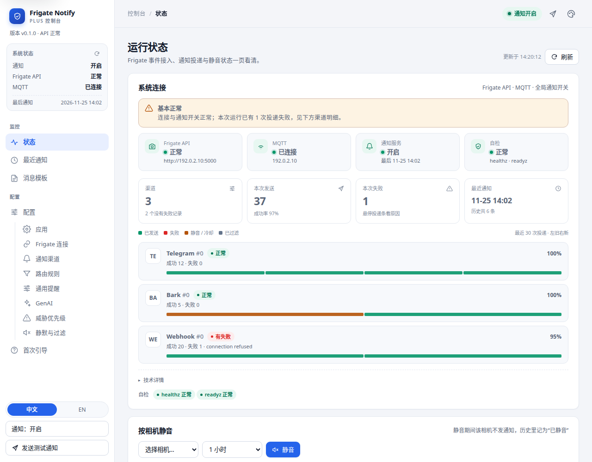
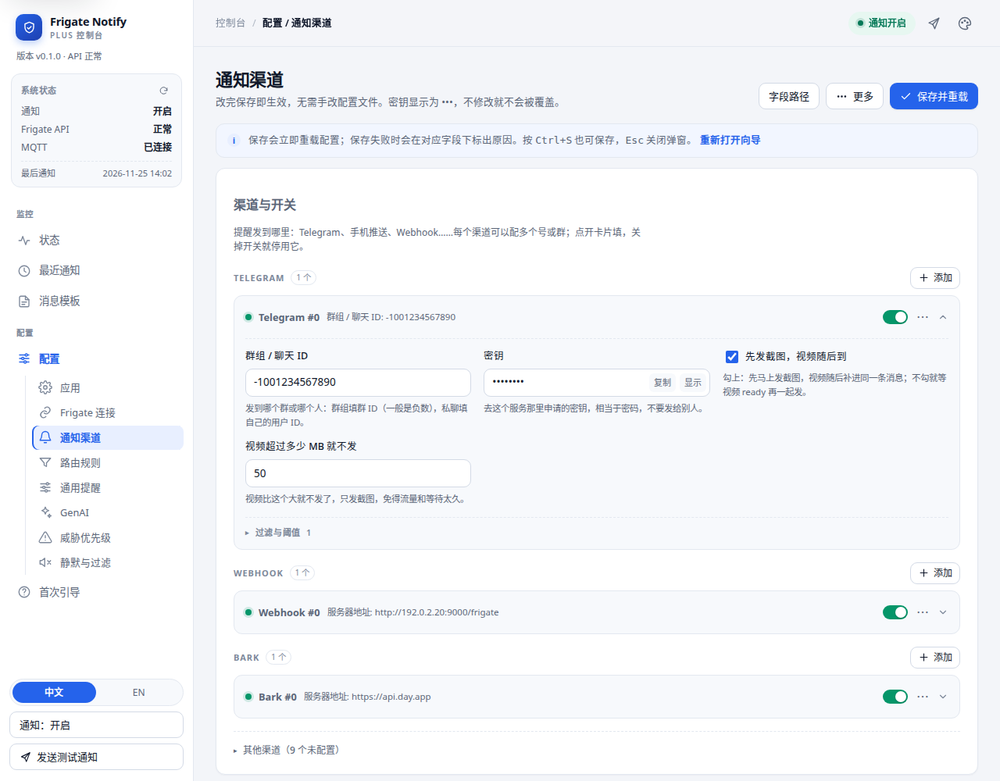
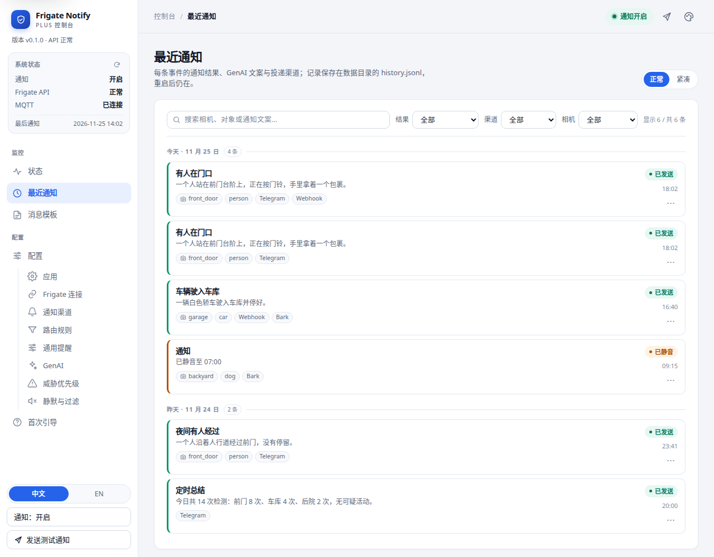
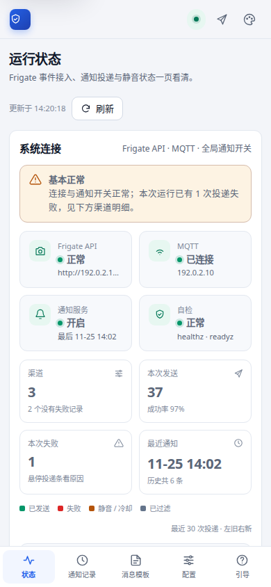

[English](README.md) | 简体中文

# Frigate Notify Plus

[](https://github.com/izerok/frigate-notify-plus) [](https://github.com/izerok/frigate-notify-plus/releases) [](LICENSE) [](go.mod)

Frigate Notify Plus 是一个给 [Frigate](https://github.com/blakeblackshear/frigate)（0.18.x）用的小型 Go 伴随服务：把 Frigate 的 review 和事件变成内容丰富的通知——包括 Frigate 的 GenAI 评审描述——直接发到你的手机，不需要 Home Assistant。所有配置都在自带的 Web 界面里完成。它是 [0x2142/frigate-notify](https://github.com/0x2142/frigate-notify) 的 fork，保留了上游的全部功能；[主要特性](#主要特性)里列的都是这个 fork 新增的。

## 目录

- [效果图](#效果图)
- [主要特性](#主要特性)
- [安装](#安装)
- [首次运行](#首次运行)
- [文档](#文档)
- [来源](#来源)
- [许可证](#许可证)

## 效果图

Web 控制台（端口 `8000`）：侧边栏工作台，带状态仪表盘、通知历史、完整的配置表单、标签页式模板编辑器和首次引导向导。内置四套主题（默认浅色），页面可深链，手机上侧边栏变成底部导航栏。

| 状态仪表盘 | 配置——通知渠道 |
| --- | --- |
|  |  |

| 通知历史 | 手机端 |
| --- | --- |
|  |  |

更多效果图（消息模板、首次引导向导）在 [docs/screenshots/](docs/screenshots/) 里。

## 主要特性

- **通知带 GenAI 总结** —— Frigate 的 AI 标题、摘要、威胁等级和观察结论都随通知一起发出。GenAI 结果在首条提醒之后才到时，Telegram 会原地编辑同一条消息的文案，事件视频片段也可以替换进同一条消息里的截图。
- **11 个通知渠道** —— Telegram、Bark、Discord、Gotify、ntfy、Pushover、Signal、SMTP、Matrix、Mattermost 和 Webhook（再加上 Apprise 能到达的任何服务），每个渠道可配多个档案，各自带过滤条件。
- **按相机冷却** —— 全局冷却加每台相机单独覆盖，忙的相机不会淹没其他相机；被过滤或冷却挡下的提醒不消耗冷却。
- **路由规则 + GenAI 升级提醒** —— 按相机、标签、区域、子标签或威胁等级把提醒只发给选定的渠道；GenAI 更新把某个 review 的威胁等级调高时，再向升级目标补发一条全新提醒。
- **定时 GenAI 总结** —— 在固定的本地时间让 Frigate 总结一段时间窗口（比如 20:00 总结当天、07:00 总结昨夜），并把总结作为通知发出来。
- **全 Web 界面配置** —— 所有设置都是浏览器表单，带首次引导向导、一键预设、Frigate 关联（从你的 Frigate 读相机、区域、标签和 MQTT 设置）、按渠道测试通知，原始 YAML 编辑/导入/导出作为兜底。不用手写配置文件。
- **数据目录持久化** —— 只挂一个目录，配置、日志、消息模板、静音状态和通知历史都在里面，删容器重建也不丢。
- **无鉴权、只放局域网** —— Web 界面和 API 只打算在本地网络用，不要把 `8000` 端口暴露到公网。

## 安装

你需要：局域网上能访问的 Frigate 0.18.x，以及运行本服务的机器上装好 Docker。GenAI 功能还需要在 Frigate 里配好 [GenAI](https://docs.frigate.video/configuration/genai/)，且 provider 要带 `descriptions` 角色。

Release 都是 prerelease，形式是 Docker 镜像的 `.tar.gz` 包加 `sha256sums.txt`，没有镜像仓库版。最新版是 `v0.1.0`。把两个文件都下载下来，校验通过后加载并运行：

```bash
curl -LO https://github.com/izerok/frigate-notify-plus/releases/download/v0.1.0/frigate-notify-plus-webui-52e7e9a.tar.gz
curl -LO https://github.com/izerok/frigate-notify-plus/releases/download/v0.1.0/sha256sums.txt
sha256sum -c sha256sums.txt
docker load -i frigate-notify-plus-webui-52e7e9a.tar.gz
docker run -d --name frigate-notify-plus --network host \
  -v /srv/frigate-notify-plus:/data \
  -e TZ=Asia/Shanghai \
  frigate-notify-plus:webui-52e7e9a
```

把宿主机目录挂到 `/data`（`/srv/frigate-notify-plus` 换成你自己的路径），并把 `TZ` 设成你的时区——定时总结按容器本地时间跑。docker-compose 示例和其他安装方式见 [docs/install.md](docs/install.md)。

## 首次运行

在局域网里用浏览器打开 `http://<主机>:8000`。数据目录是空的时候，服务会以设置模式启动：向导会检查你的 Frigate 地址、帮你选事件来源（MQTT，推荐；或 Frigate Web API——两者只能选一个）、配好第一个通知渠道，并发一条测试通知。之后所有配置都在控制台里完成。默认模式是 `reviews`（Frigate 的 review 告警才提醒；`events` 是每次检测都提醒），Web 界面/API 的 `8000` 端口在这个 fork 里默认开启。

数据目录里有 `config.yml`、`logs/`、`mute.json`、`templates/` 和 `history.jsonl`，配置、日志、模板改动和历史都跨容器重建保留——删容器不会删数据。

> [!WARNING]
> Web 界面和 API **没有鉴权**，只打算在**局域网**内使用。不要把 8000 端口暴露到公网。

## 文档

完整文档站：**https://izerok.github.io/frigate-notify-plus/**

- [配置参考](docs/config/file.md) —— 每个配置项的说明；另见[配置选项](docs/config/options.md)、[档案与过滤](docs/config/profilesandfilters.md)和[示例配置](docs/config/sample.md)。
- [消息模板](docs/config/templates.md) —— 模板语法和可用变量。
- [REST API](docs/api.md) —— `8000` 端口上的全部接口（交互式文档在 `:8000/docs`，OpenAPI 规范在 `:8000/openapi.json`）。
- [安装与设置](docs/install.md) —— 环境变量（`FN_` 前缀）、Docker secrets、不用 Docker 运行。
- [更新日志](docs/changelog.md) —— 上游历史，这个 fork 的改动在最上面的 **Unreleased** 里；也见 [Release 说明](https://github.com/izerok/frigate-notify-plus/releases)。

报 bug 或提需求请开 [issue](https://github.com/izerok/frigate-notify-plus/issues)，附上版本号（release tag）、相关配置片段（密钥打码）和状态页上显示的该渠道报错。从源码构建需要 Go 1.25+ 并带 `goolm` 构建标签（`go build -tags goolm .`）；端到端验证在 `test/verify/`，由 GitHub Actions 的 `webui-verify` 工作流跑。

## 来源

这个项目是 Matt Schmitz 的 [0x2142/frigate-notify](https://github.com/0x2142/frigate-notify) 的 fork，许可证为 MIT。GenAI 与 Telegram 视频片段的工作基于 [nikosch86/frigate-notify](https://github.com/nikosch86/frigate-notify)（`telegram-clip-transcode` 分支），按相机冷却基于 [t1m0thyj/frigate-notify](https://github.com/t1m0thyj/frigate-notify)（上游 PR [#395](https://github.com/0x2142/frigate-notify/pull/395)）。

## 许可证

MIT —— 见 [LICENSE](LICENSE)。Copyright (c) 2023-2026 Matt Schmitz。
